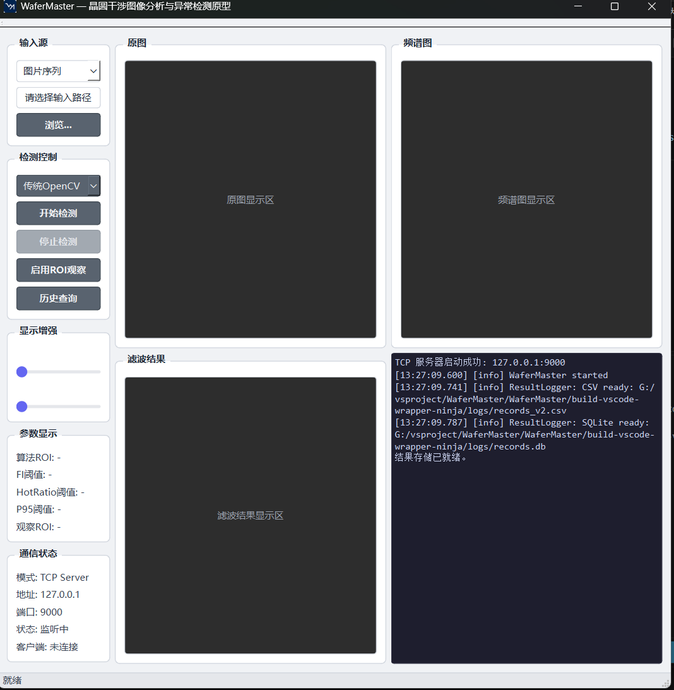
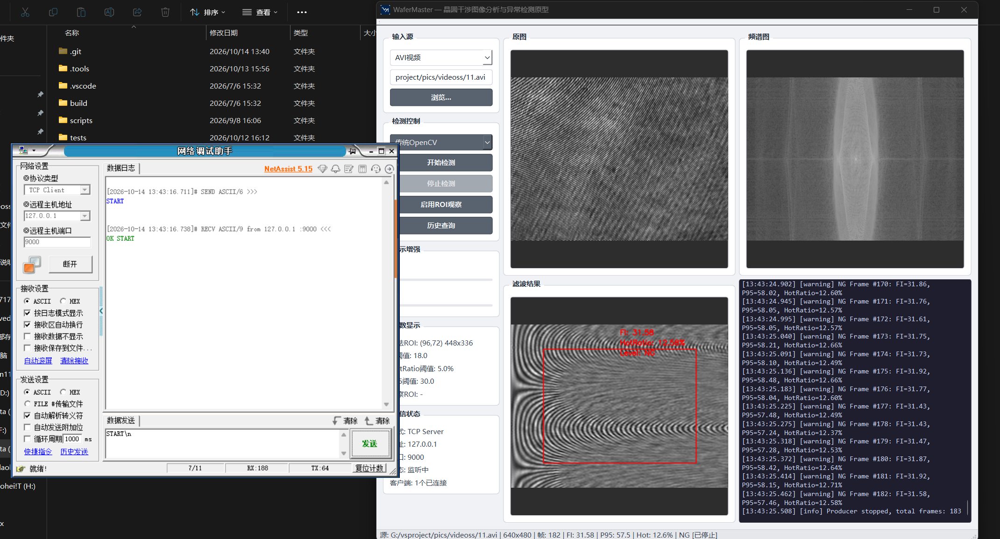
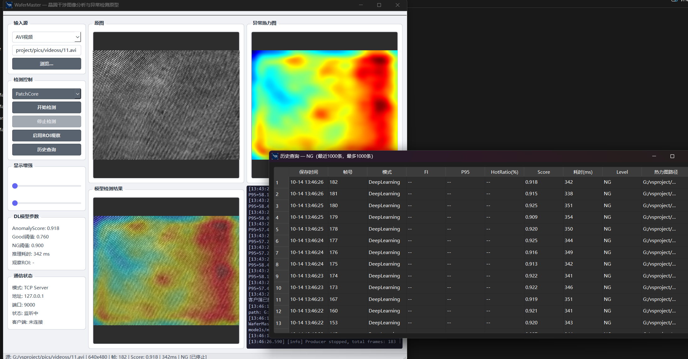
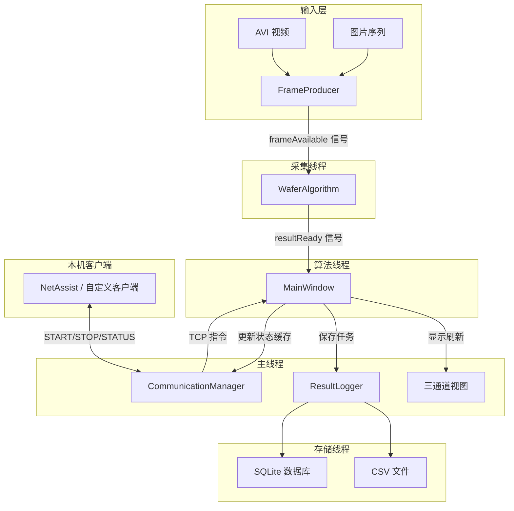

# WaferMaster — 晶圆干涉图像检测系统

基于 **OpenCV + Qt 6 + ONNX Runtime** 的晶圆（Wafer）干涉图像检测桌面应用，支持 AVI 视频 / 图片序列输入、传统频域分析与 PatchCore 异常检测，提供 Good / Warning / NG 分级、结果存储及 TCP 控制接口。

<p align="center">
  
  
  
  
  
  
  
  
</p>

---

## 功能特性

- **多输入源支持**：AVI 视频文件 或 图片序列文件夹，可配置帧间隔模拟帧率
- **传统算法**：灰度化 → 极坐标变换 → DFT → 圆环带通滤波 → IDFT → 三指标判定
  - **FI**：滤波后 ROI 内像素值的标准差
  - **P95**：滤波后 ROI 内像素值的第 95 百分位
  - **HotRatio**：ROI 内滤波值超过指定像素阈值的比例
- **深度学习检测**：PatchCore 模型通过 ONNX Runtime 执行 CPU 推理，输出异常分数与热力图
- **三级判定**：🟢 Good（正常）/ 🟡 Warning（警告）/ 🔴 NG（异常）
- **三视图可视化**：原图 + 频谱图 / 异常热力图 + 滤波结果 / 模型叠加图
- **观察 ROI**：框选区域查看局部原图和结果图，不改变检测范围；传统滤波图与原图坐标不直接对应
- **双写存储**：CSV + SQLite 记录两种模式的结果，支持按等级查询最近最多 1000 条记录，DL 彩色热力图另存 PNG
- **TCP 控制**：内置本机 TCP Server，可通过 NetAssist 等工具发送 `START` / `STOP` / `STATUS` 指令
- **自适应缩放**：窗口全屏/恢复时图像自动适配
- **实时日志**：spdlog 日志系统，同时输出到文件和控制台面板

结果默认保存至程序目录下的 `logs/records_v2.csv`、`logs/records.db` 和 `logs/heatmaps/`，旧版 `records.csv` 不覆盖。

---

## 截图概览







---

## 技术栈

| 组件 | 版本 | 用途 |
|------|------|------|
| C++ | 17 | 核心语言标准 |
| Qt 6 | 6.10.2 (msvc2022_64) | GUI 框架 + 网络 + SQL |
| OpenCV | 4.12.0 | 图像处理与频域分析 |
| ONNX Runtime | Windows x64 | PatchCore 模型推理 |
| spdlog | 1.14.1 | 日志记录与滚动文件 |
| SQLite | 3 (via Qt SQL) | 检测结果持久化 |
| CMake | 3.25+（使用预设） | 跨平台构建系统 |
| MSVC | 2022 | Windows 编译器 |

---

## 项目结构

以下为仓库中 `WaferMaster/` 子目录；根目录另有 `README.md`、`scripts/`（构建脚本）和 `docs/images/`（截图）。

```
WaferMaster/
├── CMakeLists.txt              # CMake 构建配置
├── CMakePresets.json           # CMake 预设（Debug/Release）
├── .gitignore
├── include/
│   ├── Common.h                # 枚举、配置结构体、结果载体
│   ├── MainWindow.h            # 主窗口（线程编排、UI 刷新）
│   ├── WaferAlgorithm.h        # 帧处理与双模式调度
│   ├── DeepWaferDetector.h     # PatchCore ONNX 推理
│   ├── FrameProducer.h         # 采集层（AVI/图片序列→帧队列）
│   ├── CommunicationManager.h  # TCP 通信管理（远程控制）
│   ├── ResultLogger.h          # 持久化存储（CSV + SQLite）
│   ├── RoiViewerDialog.h       # 观察 ROI 弹窗
│   └── Logger.h                # spdlog 封装
├── src/                        # 源文件实现
│   ├── main.cpp
│   ├── MainWindow.cpp
│   ├── WaferAlgorithm.cpp
│   ├── DeepWaferDetector.cpp
│   ├── FrameProducer.cpp
│   ├── CommunicationManager.cpp
│   ├── ResultLogger.cpp
│   └── RoiViewerDialog.cpp
├── ui/
│   └── WaferMaster.ui          # Qt Designer UI 布局
├── resources/
│   ├── app.rc                  # Windows 资源文件
│   └── resources.qrc           # Qt 资源集合
├── onnxruntime/                # ONNX Runtime 头文件与库目录
├── models/                     # ONNX 模型（需另行准备）
└── spdlog/                     # spdlog 源码（v1.14.1，静态链接）
```

---

## 架构设计



**线程模型**：采集、算法、存储各自运行在独立 `QThread`，通过信号槽跨线程通信，交接图像时使用 `clone()` 保留副本。主线程负责界面和 TCP 事件处理。

---

## 算法流程

**传统模式：**

```
输入帧 → 灰度化 → warpPolar 极坐标展开
         → DFT 傅里叶变换 → shiftDFT 频谱中心化
         → 圆环带通掩膜（保留指定频段）
         → IDFT 逆变换 → 极坐标滤波图中心 ROI 裁切
         → 计算 FI / p95 / HotRatio
         → classify() 判定 Good / Warning / NG
```

**PatchCore 模式：**

```
输入帧 → 三通道 / resize 256×256 / 像素除以255 / NCHW
         → ONNX Runtime CPU 推理
         → pred_score + anomaly_map
         → Good / Warning / NG + 热力图与叠加图
```

当前模型不额外做 ImageNet mean/std 归一化，分级阈值默认为 0.76、0.90；更换模型时需核对预处理、输入输出与阈值。

传统指标反映滤波后的纹理变化，PatchCore 分数反映模型判断的图像异常，均不直接给出物理平坦度。当前模型在真实数据上的检测效果仍需验证。

---

## 通信协议

基于纯文本 TCP，每行一条指令（UTF-8），默认监听本机 `127.0.0.1:9000`。指令必须以换行符结束。

| 指令 | 功能 | 响应 |
|------|------|------|
| `START` | 请求启动检测 | `OK START` |
| `STOP` | 请求停止检测 | `OK STOP` |
| `STATUS` | 查询当前状态 | `STATUS state=... frame=...` + 最近结果 |

NetAssist 选择 **TCP Client / ASCII**，连接 `127.0.0.1:9000`，勾选“自动解析转义符”后发送 `START\n`、`STOP\n` 或 `STATUS\n`（`n` 小写）。

START/STOP 的 OK 表示命令已接收，执行结果查看界面或查询 STATUS。STATUS 按模式返回传统指标或 DL 分数、耗时，不主动广播。

---

## 构建指南

### 前置依赖

1. **Visual Studio 2022**（含 MSVC v143 工具链）
2. **Qt 6.10.2**（msvc2022_64），当前配置路径 `G:/qt/6.10.2/msvc2022_64`
3. **OpenCV 4.12.0**，当前配置路径 `F:/opencv/opencv/build`
4. **CMake 3.25+ / Ninja**
5. **ONNX Runtime Windows x64 SDK**：头文件、`.lib` 和 `.dll` 需配套，仓库当前头文件 API 版本为 27
6. **ONNX 模型**：`WaferMaster/models/model_curved_fringe.onnx`

ONNX Runtime 的 `lib/` 目录和模型文件未纳入 Git。编译前需准备 `WaferMaster/onnxruntime/lib/onnxruntime.lib`、同目录的 `onnxruntime.dll` 及上述模型；发布包已包含运行所需的 DLL 和模型。

> ⚠️ 路径不同时，请修改 `WaferMaster/CMakeLists.txt`、`WaferMaster/CMakePresets.json` 和 `scripts/cmake-vs2022.cmd` 中的 Qt、OpenCV、MSVC、CMake 路径。

### 编译

在仓库根目录打开 PowerShell：

```powershell
cd .\WaferMaster

# 配置（Release）
..\scripts\cmake-vs2022.cmd --preset vscode-release

# 构建
..\scripts\cmake-vs2022.cmd --build --preset vscode-release
```

生成的 `WaferMaster.exe` 位于 `WaferMaster/build-vscode-release/`。Debug 使用 `vscode` / `vscode-debug` 预设，输出在 `WaferMaster/build-vscode-wrapper-ninja/`，两者目录分开。

### 打包发布（ZIP 便携版）

构建后已自动部署 Qt、OpenCV、ONNX Runtime 和模型。在仓库根目录打开 PowerShell，整理运行文件：

```powershell
$buildDir = ".\WaferMaster\build-vscode-release"
$releaseDir = ".\WaferMaster_Release_v2.0"

# 1. 新建发布目录，复制 exe、DLL 和运行库安装程序
if (Test-Path $releaseDir) { throw "发布目录已存在，请使用新的目录。" }
New-Item -ItemType Directory -Path $releaseDir
Copy-Item "$buildDir\WaferMaster.exe", "$buildDir\*.dll", "$buildDir\vc_redist.x64.exe" -Destination $releaseDir

# 2. 复制 Qt 插件和模型
$folders = "models", "platforms", "imageformats", "iconengines", "sqldrivers", "styles", "networkinformation", "tls", "generic"
foreach ($folder in $folders) {
    if (Test-Path "$buildDir\$folder") {
        Copy-Item "$buildDir\$folder" -Destination $releaseDir -Recurse
    }
}

# 3. 补充 AVI 视频解码 DLL（按本机 OpenCV 路径调整）
Copy-Item "F:\opencv\opencv\build\x64\vc16\bin\opencv_videoio_ffmpeg4120_64.dll" -Destination $releaseDir

# 4. 从发布目录运行测试，通过后打包；不包含测试生成的 logs
$packageFiles = Get-ChildItem -LiteralPath $releaseDir -Force | Where-Object { $_.Name -ne "logs" }
Compress-Archive -Path $packageFiles.FullName -DestinationPath ".\WaferMaster_Release_v2.0.zip"
```

目标机器如缺运行库，安装随包的 `vc_redist.x64.exe` 或 [VC++ x64 运行时](https://aka.ms/vs/17/release/vc_redist.x64.exe)。下载运行版见 [v2.0 Releases](https://github.com/recklevs/WaferMaster/releases/tag/v2.0)。

---

## License

仅供学习与演示用途。当前仓库未提供独立 LICENSE 文件；第三方依赖遵循各自许可证。
